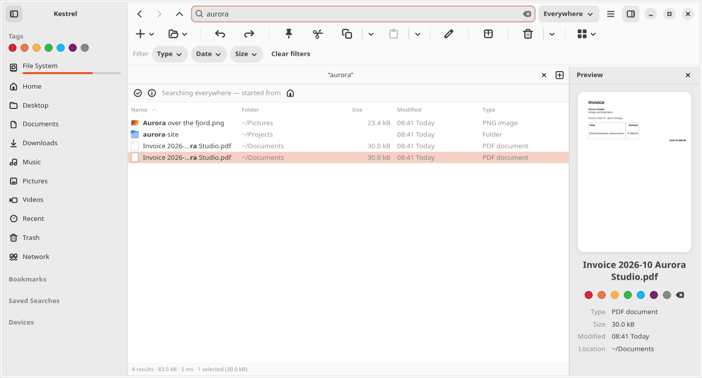
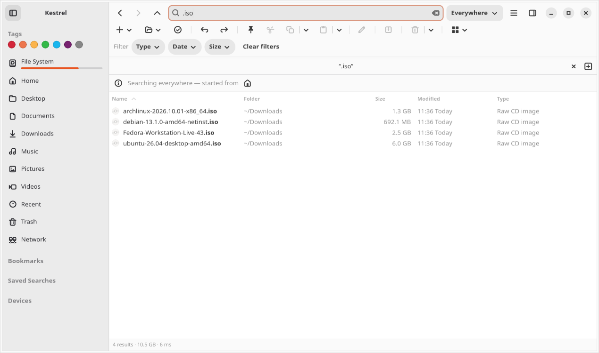
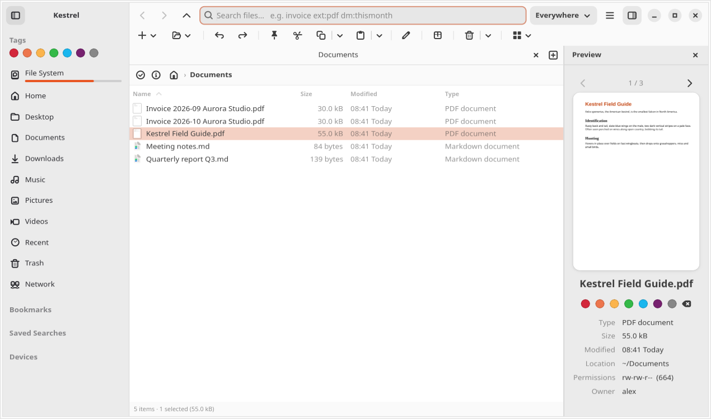
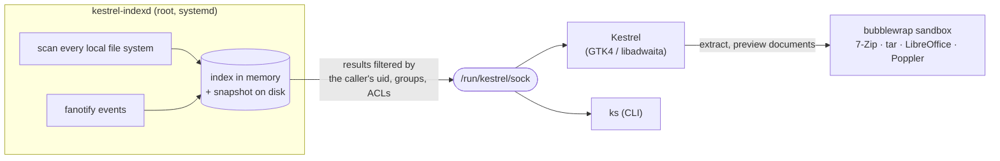

<div align="center">


# Kestrel

**Instant whole-disk search, built into a file manager that feels at home on GNOME.**

Everything-style search for Linux: every file on every local disk, found as you type, kept
live by the kernel, and filtered to what you're allowed to see.




</div>

## Why Kestrel

On Windows, [Everything](https://www.voidtools.com/) finds any file by name the instant you
type. Linux has had pieces of that (`locate` is fast but goes stale; desktop search indexes
contents but is slow to answer "where is that file called…"), but never inside the file manager
you already use.

Kestrel pairs a small root service that indexes **every local file system** (about 2.1 million
files in 5 seconds, ~230 MB of memory) and keeps it **live through fanotify**, with a full GTK4
file manager whose search box asks it. A whole-disk search answers in tens of milliseconds, and
the results only ever include files you could find yourself.

**Why the bird?** A kestrel hovers in one spot above a whole field and still sees a single mouse
move in the grass. That's the job here: keep watch over the entire disk, notice every change as
it happens, and pick out the one file you want the moment you ask for it.

<table>
<tr>
<td width="50%"></td>
<td width="50%"></td>
</tr>
<tr>
<td align="center"><sub>Search understands types: <code>.iso</code>, <code>pdf</code>, <code>excel</code></sub></td>
<td align="center"><sub>Preview PDFs, Office documents, Markdown, media and archives</sub></td>
</tr>
</table>

## Features

**Search**
- Results while you type, across every local disk, USB drives included the moment they mount
- Everything's query language: wildcards, `|` OR, `!` NOT, `<groups>`, `regex:`, `size:`, `dm:`, `ext:`, `dupe:`, `content:`…
- Type-aware: `.deb` lists .deb files first; `pdf`, `word`, `excel`, `powerpoint` also find files of that type (`budget excel` finds `Budget.xlsx`)
- Scope switch (Everywhere / This folder / This folder only), filter chips, match highlighting, recent and saved searches, a syntax cheat sheet in the menu
- `ks`: the same search on the command line, like Everything's `es.exe`

**File manager**
- Tabs, dual pane (F3), details / grid / column views, session restore
- Editable path bar (Ctrl+L), bookmarks shared with GNOME Files, Trash with restore
- A Network page like GNOME Files': connected shares, servers you've used (shared with Files), what's on your network, and Connect to Server
- Copy, move, rename, undo; clipboard compatible with GNOME Files; drag and drop
- Name clashes ask *Skip / Keep Both / Replace*; one failed item never stops a batch
- Batch rename: find and replace (or regex), case changes, numbering, live preview
- Colour tags, git status column and branch, symlink badges, free-space bars on drives
- Command palette (Ctrl+Shift+P), terminal panel that follows the folder (Ctrl+\`)
- Properties with checksums (MD5, SHA-1, SHA-256) and paste-to-verify; folder sizes instantly from the index, or on request (Calculate) for network shares
- Right-click scripts from `~/.local/share/nautilus/scripts`, run exactly as GNOME Files runs them
- Can be your default file manager, including "Show in Folder" from other apps

**Archives**
- Extract Here / Extract To… for [70 formats](docs/extract-formats.md): zip, 7z, rar, tarballs, cab, iso, dmg, vhd(x), qcow2, deb, rpm, msi, wim, squashfs…
- Split and multi-volume sets (`.001`, `.z01`, `.part1.rar`, `.r00`), password prompts, progress with time left, Cancel
- Double-click a zip, rar or tarball to browse it like a folder
- Every format is checked by an automated test

**Previews**
- Every image format your system can decode (PNG, JPEG, WebP, AVIF, HEIC, JPEG XL, SVG, BMP, TIFF, GIF, ICO, TGA, QOI…)
- Video and music in every common codec (MP3, WAV, FLAC, AAC, Opus…); music shows its cover art, title, artist and album, with previous / next through the folder, a seek bar and repeat
- Text, and Markdown rendered as a page like PDFs
- Kiwix `.zim` archives (offline Wikipedia and friends): title, description, article count
- Nextcloud Whiteboard and Excalidraw drawings (`.whiteboard`, `.excalidraw`), drawn
- Thumbnails for PDFs, documents, images and video in every view
- PDF, Word, Excel, PowerPoint and OpenDocument pages, one at a time
- Archive contents; folder totals (instant, from the index)

## How it works



- **The index** holds names, sizes, times, permissions and ACLs, never file contents. It is
  saved to `/var/lib/kestrel` (root only), so search works the moment you log in while a fresh
  scan runs in the background.
- **Live updates** come from fanotify, which reports changes for whole file systems: new,
  renamed and deleted files are searchable within a second. If the kernel ever drops events, the
  service notices and rescans.
- **Privacy:** any user may ask, but every answer is filtered by the asker's own uid, groups and
  ACLs, which the kernel reports for the connection. Files inside someone else's private folder
  never appear, and `content:` opens files *as the asking user*, so the kernel itself enforces
  their permissions. Each user gets a bounded number of connections and request size, and the
  service runs under systemd memory and task limits.
- **Untrusted files are opened in a sandbox.** Archive extraction and document rendering run
  under bubblewrap: no network, your home folder hidden, only the output folder writable. A
  hostile archive can't write anywhere else, whatever paths it contains.
- **7-Zip is bundled** (the official 26.05 build, checked against its published SHA-256):
  Ubuntu's package trails on decoder security fixes and can't read RAR.

## Install

Kestrel targets **Ubuntu 26.04** (amd64). Build the package and install it:

```sh
cargo deb -p kestrel
sudo apt install ./target/debian/kestrel_*_amd64.deb
```

apt lists anything missing and asks once. The package starts the index service; to make Kestrel
your default file manager, switch it on in **Preferences**.

<details>
<summary><b>Dependencies</b></summary>

**Runtime** (declared in the package):

| Package | For |
|---|---|
| libgtk-4-1, libadwaita-1-0, GLib, Pango, gdk-pixbuf, graphene, zlib | the app |
| libvte-2.91-gtk4-0 | terminal panel |
| bubblewrap | sandbox for extracting and document previews |
| tar, gzip, xz-utils, bzip2, zstd | tarballs |
| gvfs | Trash, Recent, Network |
| xdg-utils | default file manager hookup |
| pkexec | starting the service, editing excluded folders |

**Recommended** (installed by default):

| Package | For |
|---|---|
| gvfs-backends | browsing inside archives; network places (SFTP, SMB…) |
| poppler-utils | PDF previews |
| libreoffice-writer, -calc, -impress | Word, Excel, PowerPoint and OpenDocument previews |
| gstreamer1.0-libav, -plugins-good, -bad, -ugly | playing every common audio and video codec |
| ncompress | `.tar.z` / `.taz` |
| xdg-terminal-exec | "Open in Terminal" with your chosen terminal |

**Build** (Rust 1.88 or newer):

```sh
sudo apt install build-essential pkg-config libgtk-4-dev libadwaita-1-dev \
  libvte-2.91-gtk4-dev libgstreamer1.0-dev zlib1g-dev
cargo install cargo-deb
```

libgit2 is compiled in; PDF pages use the `poppler-utils` commands and video uses GTK's own
GStreamer. Music plays through Kestrel's own small GStreamer player (audio only, so it needs
`libgstreamer1.0-dev` to build; at run time just the GStreamer that GNOME already has).

**Rebuilding archive test samples** (only when adding a format):

```sh
sudo apt install zip rar arj gcab xar wimtools msitools rpm genisoimage squashfs-tools \
  xorriso qemu-utils android-sdk-libsparse-utils ncompress zstd cpio
```

</details>

## Search syntax

| Query | Finds |
|---|---|
| `invoice 2026` | names containing both words |
| `report \| summary` | either |
| `!tmp` | names without "tmp" |
| `*.rs` · `IMG_????.jpg` | wildcards (they match the whole name) |
| `.iso` · `excel` | that type first; type words also match the type |
| `ext:jpg;png` · `pic:` `audio:` `video:` `doc:` `zip:` `exe:` `diagram:` `cad:` `gis:` `data:` `cert:` `lib:` `code:` `font:` | by extension or kind |
| `size:>1gb` · `size:huge` | by size |
| `dm:today` · `dm:last2weeks` · `dm:2026-10` | by date modified (`dc:` created, `da:` accessed) |
| `under:~/Projects` · `parent:/etc` · `depth:<3` | by place |
| `folder:` · `file:` · `empty:` | folders, files, empty folders |
| `dupe:` · `sizedupe:` | same name / same size |
| `tag:red` | colour tags |
| `content:"TODO"` | text inside files (slower; read permission checked first) |
| `regex:^\d{4}-` · `case:Readme` · `path:src/main` | regular expression, case-sensitive, full path |

Open **Search Syntax** from the menu (or the command palette, Ctrl+Shift+P) for the full cheat sheet, or run `ks --syntax`.

## Keyboard

| Keys | Action | Keys | Action |
|---|---|---|---|
| Ctrl+F | search this folder | Ctrl+Shift+F | search everywhere |
| Ctrl+L | edit location | Esc | clear search |
| Ctrl+T / Ctrl+W | new / close tab | Ctrl+N | new window |
| F3 | dual pane | F4 | switch pane |
| F7 / F8 | copy / move to other pane | Ctrl+1 / 2 / 3 | details / grid / columns |
| Space or Alt+P | preview pane | Ctrl+\` | terminal panel |
| F2 | rename (batch with several selected) | Alt+Return | properties |
| Delete / Shift+Delete | trash / delete | Ctrl+Z | undo |
| Ctrl+Shift+P | command palette | Ctrl+, | preferences |
| Ctrl+H | hidden files | F9 | sidebar |

## Development

```sh
KESTREL_7ZZ=$PWD/packaging/7zip/7zz cargo test --workspace
```

- **`every_format_extracts`** extracts a real sample of all 70 archive formats through the same
  sandbox as Extract Here, checks the contents, and checks the preview lists exactly the files
  Extract produces. Samples live in `crates/kestrel/tests/fixtures/archives/` and are built by
  `scripts/make-archive-fixtures.sh`; a new extension fails the test until it has one.
  Per-format report: `cargo test -p kestrel every_format -- --nocapture`.
- **`scripts/ui-check.sh`** drives the real app through 30 screens under a virtual display
  (views, previews, dialogs, batch rename, terminal, search and its empty/off states, a folder
  you can't open, Extract and its conflict prompt, Trash) with a throwaway home folder and its
  own small search service, checks 5 results along the way, fails on any GTK warning or error
  page, and saves every screen to `target/ui-check/`.
- **`scripts/feature-test.py`** uses the app the way a person does: it clicks, types and presses
  shortcuts through the accessibility layer under a virtual display, then checks the result on disk
  and on screen. 50 tests cover navigation, tabs, windows, session restore, views, bookmarks, dual pane,
  copy/move/rename/trash/restore/delete and name clashes, batch rename, tags, search (typing, type
  ranking, scopes, tags, content, saved searches, the query language), previews, properties and
  checksums, the palette, preferences, the terminal, Nautilus scripts, git status, opening files and
  Show in Folder. Failures leave a screenshot and a dump of what was on screen in
  `target/feature-test/`. Needs `xvfb` and `python3-xlib`.
- **`scripts/screenshots.sh`** regenerates the screenshots above from the real app and a made-up
  home folder.
- **`scripts/smoke-live.sh`** (run as yourself; it uses sudo only for a test service) checks live
  updates, permission filtering, excluded folders, and drives mounting and unmounting. Run it
  after any change to `kestrel-indexd` or `kestrel-index`.
- **7-Zip updates:** check [ip7z/7zip releases](https://github.com/ip7z/7zip/releases) monthly
  and run `scripts/update-7zip.sh VERSION` (it verifies the download's SHA-256).
- **Licence notices:** after changing dependencies, run `python3 scripts/third-party-licenses.py`
  to refresh `packaging/THIRD-PARTY-LICENSES.txt` (installed with the package).

| Path | What |
|---|---|
| `crates/kestrel` | the GTK app |
| `crates/kestrel-indexd` | the index service |
| `crates/kestrel-index` | index, scanner and query language shared by both |
| `crates/ks` | command-line search |
| `packaging/` | desktop file, icon, systemd unit, bundled 7-Zip, Debian scripts |
| `docs/extract-formats.md` | every extractable format |
| `PRD.md` · `PLAN.md` | requirements and release log · engineering notes |

## Limitations

- Ubuntu 26.04, amd64, `.deb` only for now. The index service needs root (fanotify watches whole
  file systems), so it can't ship as a Flatpak or Snap.
- Local disks only: network shares can be browsed but aren't indexed (they send no change events).
- English only; no translations yet.
- Filenames that aren't valid UTF-8 are shown with replacement characters.

## License

Kestrel is licensed under either of the [Apache License 2.0](LICENSE-APACHE) or the
[MIT License](LICENSE-MIT), at your option.

Unless you explicitly state otherwise, any contribution you submit for inclusion in Kestrel, as
defined in the Apache-2.0 license, is dual licensed as above, without any additional terms.

Licences of the Rust crates and the C libgit2 compiled into Kestrel are collected in
[packaging/THIRD-PARTY-LICENSES.txt](packaging/THIRD-PARTY-LICENSES.txt).
**Bundled:** [7-Zip](https://www.7-zip.org/) by Igor Pavlov (GNU LGPL, with the unRAR licence
restriction for RAR code; see [packaging/7zip/License.txt](packaging/7zip/License.txt)).
**Test samples:** files from [libarchive](https://github.com/libarchive/libarchive)
(BSD-2-Clause) and the [PuTTY](https://www.chiark.greenend.org.uk/~sgtatham/putty/) manual (MIT);
see [the samples' README](crates/kestrel/tests/fixtures/archives/README.md).
